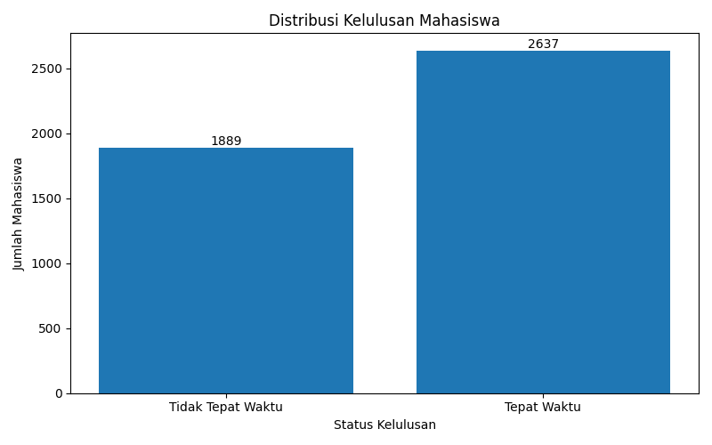

# LAPORAN PRAKTIKUM MACHINE LEARNING
## Klasifikasi Prediksi Kelulusan Mahasiswa Tepat Waktu Menggunakan Algoritma Random Forest

---

## 1. Pendahuluan

Klasifikasi Kelulusan Mahasiswa ini menggunakan Machine Learning yang diambil dari dataset `dataset_ml_kelulusan.csv` dan kami menggunakan algoritma Random Forest dengan memanfaatkan Decision Tree sebagai algoritma pembentuk pohon keputusan. Pada system ini ditujukan untuk mengolah data terkait kelulusan dan membangun model yang dapat digunakan untuk mempelajari pola pada data tersebut, yaitu apakah mahasiswa dapat lulus tepat waktu dalam kurun waktu 4 tahun atau tidak.

## 2. Tujuan Praktikum

Tujuan dari praktikum ini adalah:

1. Memahami penerapan Machine Learning dalam proses klasifikasi.
2. Mengetahui proses dari pengolahan dataset sebelum digunakan.
3. Mengetahui validitas dan jumlah data yang digunakan.
4. Memahami pembagian data training dan testing.
5. Mengimplementasikan algoritma Decision Tree dan Random Forest.
6. Mengetahui hasil klasifikasi berdasarkan data mahasiswa.

## 3. Metode Machine Learning

Metode Machine Learning yang digunakan dalam praktikum ini adalah **Supervised Learning**.

Jenis permasalahan yang kami gunakan ialah **Binary Classification**, proses dari pengelompokkan data ke dalam dua kelas.

Algoritma yang kami gunakan adalah:

**Random Forest Classifier**

Random Forest merupakan algoritma klasifikasi yang menggunakan beberapa pohon keputusan (Decision Tree). Setiap pohon menghasilkan prediksi, kemudian hasil akhir ditentukan berdasarkan suara terbanyak atau Majority Voting.

Berdasarkan kode program, konfigurasi Random Forest yang digunakan adalah:

| Parameter | Nilai |
|---|---|
| Algoritma | Random Forest |
| Jumlah Decision Tree | 10 |
| Max Depth | 10 |
| Min Samples Split | 2 |
| Metode sampling | Bootstrap Sampling |
| Metode prediksi | Majority Voting |

## 4. Data dan Sumber Data

Dataset yang digunakan dalam praktikum ini adalah:

**Nama file:** `dataset_ml_kelulusan.csv`

**Sumber data:** File dataset yang disertakan dalam paket praktikum. Informasi mengenai sumber asli atau institusi penghasil dataset tidak tercantum dalam file yang diberikan.

**Jumlah data:**

| Keterangan | Jumlah |
|---|---:|
| Total baris data | 4.526 |
| Total kolom | 12 |
| Atribut input yang digunakan | 9 |
| Atribut target | 1 |

### 4.1 Atribut Dataset

Atribut yang terdapat dalam dataset:

| No. | Nama Atribut | Keterangan |
|---|---|---|
| 1 | prodi | Kode program studi |
| 2 | status_masuk | Status masuk mahasiswa |
| 3 | jenis_kelamin | Kode jenis kelamin |
| 4 | usia_saat_masuk | Usia mahasiswa saat masuk |
| 5 | status_pegawai | Status kepegawaian |
| 6 | sks_semester_1_4 | Jumlah SKS semester 1–4 |
| 7 | jumlah_mk_semester_1_4 | Jumlah mata kuliah semester 1–4 |
| 8 | rata_nilai_grade_semester_1_4 | Rata-rata nilai grade semester 1–4 |
| 9 | rata_nilai_total_semester_1_4 | Rata-rata nilai total semester 1–4 |
| 10 | semester_tercatat | Semester yang tercatat |
| 11 | lama_studi_tahun | Lama masa studi mahasiswa dalam tahun |
| 12 | lulus_tepat_waktu_4tahun | Target klasifikasi kelulusan |

### 4.2 Atribut yang Digunakan

Pada program `train.py`, terdapat tiga kolom yang tidak digunakan sebagai atribut input, yaitu:

- `lulus_tepat_waktu_4tahun`
- `lama_studi_tahun`
- `semester_tercatat`

Kolom `lulus_tepat_waktu_4tahun` adalah target klasifikasi, sedangkan dua kolom lainnya dikeluarkan dari data input.
9 atribut input yang digunakan untuk proses pelatihan model.

## 5. Pemeriksaan Validitas Data

Sebelum dataset digunakan dalam proses Machine Learning, dilakukan pemeriksaan terhadap data untuk mengetahui kelengkapan dan kondisi dataset.

Hasil pemeriksaan:

| No. | Pemeriksaan | Hasil |
|---|---|---|
| 1 | Jumlah data | 4.526 |
| 2 | Jumlah atribut | 12 |
| 3 | Missing Value | 0 |
| 4 | Data duplikat | 0 |
| 5 | Tipe data | Numerik |
| 6 | Data target | Tersedia |
| 7 | Data dapat dibaca | Ya |

### Kesimpulan Validitas Data

Berdasarkan pemeriksaan dari dataset, diperoleh hasil bahwa tidak ada nilai kosong (Missing Value) dan tidak ada data duplikat sehingga dataset memenuhi pemeriksaan dasar kelengkapan data dan dapat digunakan untuk proses klasifikasi.

Semua atribut memiliki tipe data numerik, kemudian diproses oleh program yang menggunakan NumPy dan Pandas.

Pemeriksaan ini belum membuktikan kebenaran seluruh nilai data secara faktual karena tidak adanya dokumentasi sumber asli untuk melakukan verifikasi yang lebih lanjut.

## 6. Klasifikasi Class

Target klasifikasi yang digunakan dalam praktikum ini adalah:

`lulus_tepat_waktu_4tahun`

Berdasarkan program, target tersebut dibagi menjadi dua kelas.

| Class | Keterangan | Jumlah Data |
|---|---|---:|
| 0 | Tidak Tepat Waktu | 1.889 |
| 1 | Tepat Waktu | 2.637 |
| **Total** | | **4.526** |

### Penjelasan Class

- **Class 0 (Tidak Tepat Waktu):** Menunjukkan kategori mahasiswa yang tidak lulus tepat waktu.
- **Class 1 (Tepat Waktu):** Menunjukkan kategori mahasiswa yang lulus tepat waktu.

Pembagian label tersebut mengikuti keterangan yang digunakan dalam program untuk membuat grafik distribusi kelulusan.

Berdasarkan jumlah data, Class 1 memiliki jumlah data lebih banyak dibandingkan Class 0.

## 7. Pembagian Data (Data Splitting)

Pembagian dataset dilakukan menggunakan fungsi `train_test_split` dari library Scikit-Learn.

Kode yang digunakan:

```python
X_train, X_test, y_train, y_test = train_test_split(
    X, y, test_size=0.2, random_state=42
)
```

Pembagian data dilakukan dengan komposisi:

- 80% untuk Data Training.
- 20% untuk Data Testing.

Hasil pembagian data:

| Jenis Data | Jumlah | Persentase |
|---|---:|---:|
| Data Training | 3.620 | 80% |
| Data Testing | 906 | 20% |
| **Total** | **4.526** | **100%** |

### 7.1 Distribusi Class Setelah Splitting

| Class | Data Training | Data Testing |
|---|---:|---:|
| 0 - Tidak Tepat Waktu | 1.507 | 382 |
| 1 - Tepat Waktu | 2.113 | 524 |
| **Total** | **3.620** | **906** |

Data training digunakan untuk melatih model Random Forest, sedangkan data testing digunakan untuk menguji hasil prediksi model.

Pembagian menggunakan `random_state=42` agar pembagian data dapat direproduksi dengan konfigurasi yang sama.

## 8. Proses Pengolahan Data

Proses pengolahan dataset dilakukan melalui beberapa tahapan sesuai dengan kode pada `train.py`.

Tahapan yang dilakukan adalah:

1. Membaca dataset menggunakan Pandas.
2. Memisahkan atribut input dan target klasifikasi.
3. Mengeluarkan kolom target, lama studi, dan semester tercatat dari atribut input.
4. Mengubah atribut input menjadi tipe data float.
5. Mengubah target menjadi tipe data integer.
6. Membagi data menjadi training dan testing.
7. Melatih model menggunakan algoritma Random Forest.
8. Melakukan prediksi terhadap data testing.
9. Menghitung nilai accuracy.
10. Menampilkan Classification Report dan Confusion Matrix.
11. Membuat grafik distribusi kelulusan mahasiswa.

## 9. Implementasi Algoritma

Implementasi program terdiri dari tiga file Python.

### 9.1 DecisionTree.py

File yang berisi implementasi algoritma Decision Tree.

Beberapa proses yang terdapat di dalamnya:

- Membentuk node pada pohon keputusan.
- Menghitung Entropy.
- Menghitung Information Gain.
- Menentukan fitur dan threshold terbaik untuk pemisahan data.
- Membagi data menjadi cabang kiri dan kanan.
- Melakukan prediksi berdasarkan struktur pohon keputusan.

### 9.2 RandomForest.py

File implementasi algoritma Random Forest.

Proses yang dilakukan:

- Membuat 10 pohon keputusan.
- Melakukan Bootstrap Sampling pada data training.
- Melatih setiap pohon keputusan.
- Menggabungkan hasil prediksi dari seluruh pohon.
- Menentukan hasil akhir berdasarkan Majority Voting.

### 9.3 train.py

File yang merupakan program utama untuk menjalankan proses Machine Learning.

Proses yang dilakukan:

- Membaca dataset CSV.
- Melakukan pemisahan data input dan target.
- Membagi dataset menjadi training dan testing.
- Melatih model Random Forest.
- Melakukan prediksi.
- Menghitung Accuracy.
- Menampilkan Classification Report.
- Menampilkan Confusion Matrix.
- Membuat grafik distribusi kelulusan mahasiswa.

## 10. Evaluasi Model

Evaluasi model dilakukan menggunakan beberapa metode pengukuran yang terdapat dalam program `train.py`.

### 10.1 Accuracy

Accuracy digunakan untuk mengetahui persentase prediksi yang benar dibandingkan dengan seluruh data testing.

### 10.2 Precision

Precision digunakan untuk mengetahui ketepatan model ketika memprediksi suatu kelas.

### 10.3 Recall

Recall digunakan untuk mengetahui kemampuan model dalam menemukan seluruh data yang benar-benar termasuk ke dalam suatu kelas.

### 10.4 F1-Score

F1-Score merupakan nilai yang menggabungkan Precision dan Recall.

### 10.5 Confusion Matrix

Confusion Matrix digunakan untuk melihat perbandingan antara hasil prediksi model dengan kelas sebenarnya.

Program menampilkan hasil evaluasi menggunakan kode:

```python
print(acc)

print("\nClassification Report:")
print(classification_report(y_test, prediction))

print("\nConfusion Matrix:")
print(confusion_matrix(y_test, prediction))
```

**Catatan hasil pengujian:** Nilai Accuracy, Precision, Recall, F1-Score, dan Confusion Matrix diperoleh ketika program dijalankan. Nilainya tidak ditetapkan secara permanen dalam file Python karena proses Bootstrap Sampling dan pemilihan fitur menggunakan randomisasi.

## 11. Grafik Distribusi Kelulusan

Program `train.py` juga menggunakan Matplotlib untuk menampilkan grafik distribusi kelulusan mahasiswa.

Grafik memiliki dua kategori:

- Tidak Tepat Waktu.
- Tepat Waktu.



Jumlah data yang ditampilkan pada grafik:

| Status Kelulusan | Jumlah |
|---|---:|
| Tidak Tepat Waktu | 1.889 |
| Tepat Waktu | 2.637 |

Grafik tersebut digunakan untuk mengetahui perbandingan jumlah mahasiswa berdasarkan status kelulusannya.

## 12. Kesimpulan

Berdasarkan praktikum Machine Learning yang telah dilakukan, dapat disimpulkan bahwa algoritma Random Forest digunakan untuk melakukan klasifikasi prediksi kelulusan mahasiswa tepat waktu dalam kurun waktu 4 tahun.

Dataset yang digunakan memiliki 4.526 baris data dan 12 kolom atribut. Berdasarkan pemeriksaan dasar, tidak ditemukan missing value maupun data duplikat.

Target klasifikasi terdiri dari dua kelas, yaitu Class 0 (Tidak Tepat Waktu) sebanyak 1.889 data dan Class 1 (Tepat Waktu) sebanyak 2.637 data.

Pembagian dataset dilakukan dengan perbandingan 80% data training dan 20% data testing, sehingga diperoleh 3.620 data training dan 906 data testing.

Algoritma Random Forest menggunakan 10 Decision Tree dengan metode Bootstrap Sampling dan Majority Voting untuk menghasilkan prediksi.

Evaluasi model dilakukan menggunakan Accuracy, Precision, Recall, F1-Score, dan Confusion Matrix.

Dengan demikian, praktikum ini menunjukkan penerapan proses klasifikasi Machine Learning mulai dari pembacaan dataset, pemeriksaan data, pembagian data, pelatihan model, hingga evaluasi hasil prediksi.
